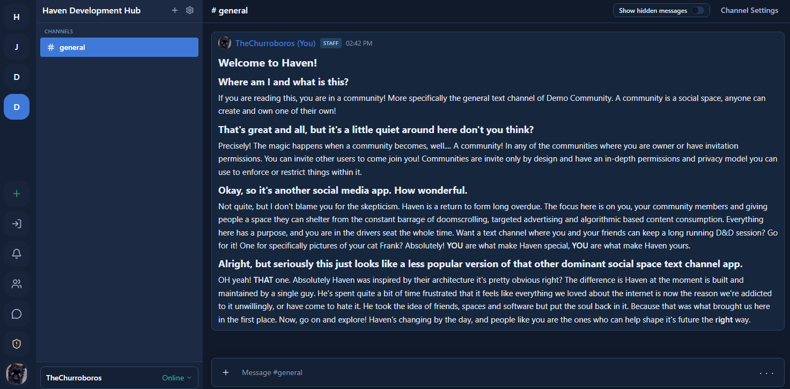

# Haven

**Community chat for people who give a damn.**

[](#platforms)
[](#stack)
[](#stack)
[](https://github.com/redrix-dev/haven/actions/workflows/ci.yml)
[](./LICENSE.md)

Haven is a place for a community to talk: text, voice, and the people you
actually know. No feeds, no ads, no algorithm deciding what you see. It runs on
iPhone, on Windows and macOS, and in the browser.

It started because the chat apps my friends and I used stopped feeling like
they were made for us. Building one that did seemed worth the effort.



## What you can do

- **Communities.** Invite-only spaces with channels, categories, roles and
  permissions you can read and understand.
- **Text channels.** Markdown, replies, reactions, images and link previews.
- **Voice channels.** Drop in and talk, on desktop, web and iPhone.
- **Conversations.** Direct messages, one to one.
- **Friends.** Add someone by username, or share a friend link.
- **Notifications.** In the app and as push notifications on iPhone. Mute a
  channel or a conversation when it gets noisy.
- **Privacy.** You choose who can message you, who can send you a friend
  request, and who sees your bio.
- **Moderation.** Reports, modmail, kicks and bans, for the people running a
  community and for Haven itself.
- **Themes.** Several, saved to your account so they follow you.

## Platforms

- **iPhone:** through TestFlight.
- **Desktop:** Windows and macOS, built with Tauri. The last release is
  `3.0.0`.
- **Web:** the same app as desktop, served from Vercel.

All three talk to the same database and share the same core logic, so they
behave the same way.

A Linux desktop build lives in the repo but isn't shipped. Voice on Linux
needs a native helper of its own, and nobody using Haven needs it yet.
[NATIVE_VOICE.md](docs/architecture/NATIVE_VOICE.md) covers what bringing it
back would take.

## Status

Haven is one person's project, worked on in bursts. Right now nobody uses it
day to day; the group of friends it was built for has moved on. That made it a
good time to start the foundation over.

In November 2026 the database was rebuilt from scratch around what the product
needs, and all three apps were moved onto it. Next is testing that work on
real devices and shipping new builds.

Bugs and ideas go in [GitHub Issues](https://github.com/redrix-dev/haven/issues).
They may sit a while, but they are read.

## Stack

| Part          | What it uses                                                     |
| ------------- | ---------------------------------------------------------------- |
| Desktop & web | Tauri v2 and Solid                                               |
| iPhone        | React Native and Expo, with its own over-the-air update pipeline |
| Shared core   | TypeScript with no UI framework, used by every app               |
| Backend       | Supabase: Postgres, Auth, Realtime, Edge Functions               |
| Voice         | LiveKit                                                          |

## How it's built

Two ideas shape most of the code:

- **The database decides who can do what.** Every permission is checked in
  Postgres. The apps show what the database allows; they can't grant anything
  it doesn't.
- **The logic is written once.** What happens when a message arrives, how a
  channel loads, what a permission means: that lives in `packages/shared` and
  every app uses it. Each app only draws the screens.

The details, including why the public Supabase key and the public source are
safe, are in [docs/ARCHITECTURE.md](docs/ARCHITECTURE.md). The documentation
starts at [docs/README.md](docs/README.md) and is meant to be enough to run
Haven against your own Supabase project.

## Running the tests

```bash
npm run test:cleave    # lint, typecheck, unit tests: the floor for every merge
npm run test:db        # the database's own tests, against local Supabase
npm run test:backend   # the apps' calls against local Supabase
```

## License

Haven is open source under the [MIT License](./LICENSE.md). Use it, fork it,
build on it.

Inquiries: legal@redrixx.com
